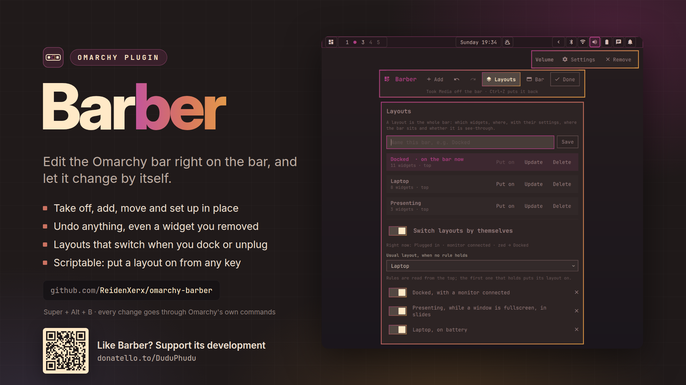

# Barber

**Edit the Omarchy bar on the bar itself.**



Press <kbd>Super</kbd> + <kbd>Alt</kbd> + <kbd>B</kbd> (or open the Omarchy menu → Style → Menu Bar → *Edit on the bar*).
Every widget on the bar gets a frame. Pick one, move it, take it off, add a new one next to it, or change its
settings right where it sits, and undo any of it.

## What only Barber does

- **Edit where the widgets are.** No list of ids in a settings window: the frames sit over the real widgets.
  Delete takes one off, Enter opens its settings, A adds a widget right after the one you picked.
- **Undo and redo for every change.** Even a widget you took off comes back in the same place, with its options.
- **Layouts that switch by themselves.** Save the bar as a layout ("Docked", "Battery", "Presenting") and add rules:
  *with a monitor connected*, *on battery*, *while a window is fullscreen*, *in this app*. The first rule that holds puts
  its layout on; with none holding, your usual layout comes back.
- **Careful with plugins that are more than a button.** For many plugins, being on the bar is what keeps the whole
  plugin running. Taking one of those off asks first, because its service stops too. Automatic layouts never take such a
  widget off.
- **Scriptable.** Save and switch layouts from a key binding or a script:
  `omarchy-shell shell call reidenxerx.barber wear Docked`.

## Edit mode

| Key | Does |
| --- | --- |
| <kbd>←</kbd> <kbd>→</kbd> (or <kbd>↑</kbd> <kbd>↓</kbd>) | pick the widget before or after |
| <kbd>Shift</kbd> + arrows | move the picked widget one place, across sections too |
| <kbd>Tab</kbd> | next widget, including ones on the bar that are not showing right now |
| <kbd>Delete</kbd> | take the picked widget off the bar |
| <kbd>Enter</kbd> | its settings (also double-click or right-click) |
| <kbd>A</kbd> | add a widget: search, then <kbd>Enter</kbd> |
| <kbd>L</kbd> | layouts and rules: type a name and <kbd>Enter</kbd> to save the bar |
| <kbd>B</kbd> | the bar: top, bottom, left or right; see-through; the shortcut |
| <kbd>Ctrl</kbd> + <kbd>Z</kbd> / <kbd>Ctrl</kbd> + <kbd>Shift</kbd> + <kbd>Z</kbd> | undo / redo |
| <kbd>Esc</kbd> | close the open card, or leave edit mode |

With the mouse: click a widget to pick it and drag it to move it. A marker shows where it will land.

Settings come from each widget's own manifest, so plugins with settings get a form automatically. The spacer, clock
and weather use Omarchy's own fields.

## Layouts and rules

A layout is the whole bar: which widgets, in what order, with their settings, where the bar sits and whether it is
see-through. In the Layouts card:

- **Save** stores the bar as it is now. **Update** overwrites a layout with the bar as it is now.
- **Put on** switches to a layout, and undo takes it back.
- **Switch layouts by themselves** turns the rules on. The card shows what the rules see right now
  ("Plugged in · monitor connected · kitty → Docked").
- **Usual layout** is the one put back when no rule holds.

Rules are read from the top. While edit mode is open nothing switches under your hands; a switch that was due happens
when you leave.

## From scripts

```sh
omarchy-shell shell call reidenxerx.barber layouts ""        # ["Docked","Battery"]
omarchy-shell shell call reidenxerx.barber save Docked
omarchy-shell shell call reidenxerx.barber wear Battery
omarchy-shell shell call reidenxerx.barber forget Battery
omarchy-shell shell call reidenxerx.barber auto toggle       # on | off | toggle
omarchy-shell shell toggle reidenxerx.barber '{"panel":"layouts"}'   # edit mode, on the layouts card
```

## Install

```sh
omarchy plugin add https://github.com/ReidenXerx/omarchy-barber --enable
~/.config/omarchy/plugins/reidenxerx.barber/bin/barber-menu-install          # menu entries under Style → Menu Bar
```

`barber-menu-install remove` takes the menu entries out again. The shortcut can be changed or turned off in edit mode
(<kbd>B</kbd>).

## How it stays safe

- Barber never writes the bar into `shell.json` itself. Every change goes through the shell's own commands
  (`omarchy-shell shell moveBarWidget …`, `omarchy bar position …`), so the shell checks it exactly as it checks its own
  edits. Barber's settings live in its own entry in `shell.json`.
- Commands run by absolute path, one at a time, each with a deadline; what they print is size-checked before it is
  read. Widget manifests are read only from Omarchy's plugin folders, with a size cap.
- Undo remembers the bar it was recorded on. If something else changed the bar in the meantime, Barber clears the
  history instead of replaying it onto different widgets.
- The shortcut is bound only when those keys are free, and taken back when Barber stops.

## Limits

- A widget that is on the bar more than once (such as a spacer) can be moved and set up, but not taken off one at a
  time: the shell only removes all of them together.
- With several monitors, edit mode draws over the first screen's bar. The layout itself is shared by every bar.
- Rules match an app by text in its window class or title.

## Tests

```sh
node tests/model-test.js            # the bar, changes and their undo, layouts, rules, forms, shortcuts
python3 tests/menu_install_test.py  # the menu installer, in a sandbox
```

## Support

If Barber is useful to you, you can support its development on [Donatello](https://donatello.to/DuduPhudu).

MIT license.
